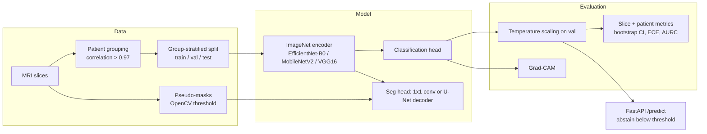

# Neurodegenerative Disease Detection from MRI

Multi-task CNNs for 2D MRI slices, with an evaluation protocol designed to catch the
mistakes common in this area: patient leakage, missing baselines, and uncalibrated
confidence.

- **Alzheimer's:** 4-class staging (NonDemented, VeryMildDemented, MildDemented, ModerateDemented)
- **Parkinson's:** binary (normal vs. parkinson)

> **Research prototype, not a medical device.** The headline finding is negative: once
> patients are kept out of the test set they were trained on, Alzheimer staging from single
> slices is barely above simple baselines. See [Results](#results).

## What this repo shows

1. **Leakage is measurable.** The same EfficientNet scores **0.945 macro-F1** on a random
   image-level split, and **0.388** when whole patients are held out. Even a logistic
   regression on 32×32 thumbnails reaches 0.855 on the leaky split.
2. **Patients can be recovered from shuffled filenames.** Linking slices with pixel
   correlation > 0.97 recovers **200 patients × 32 slices**. On the 1,252 files that
   carry a patient ID in their name, precision and recall are both 1.000
   ([neurodx/grouping.py](neurodx/grouping.py)).
3. **Strong-looking results can be confounded.** Parkinson reaches 0.93 patient-level
   accuracy. But each class comes from a different scanner vendor, and only **46%** of the
   Grad-CAM attention falls inside the head.

## Architecture



## Results

All numbers below are measured, not estimated: mean ± std over seeds 0, 1 and 2, on a
held-out test set. The full tables are in [results/RESULTS.md](results/RESULTS.md), which
`python scripts/make_report.py` regenerates. The CI column is a 95% interval from a
bootstrap that resamples patients.

### Alzheimer: patient-level split (200 patients; 32 in test)

| Model | Slice macro-F1 | 95% CI | Patient-level acc. |
|---|---|---|---|
| Majority class | 0.160 | 0.12–0.25 | 0.469 |
| LogReg on intensity histogram | 0.362 ± 0.074 | 0.28–0.55 | 0.500 ± 0.143 |
| LogReg on 32×32 thumbnail | 0.285 ± 0.010 | 0.23–0.43 | 0.490 ± 0.095 |
| **EfficientNet-B0, multi-task** | **0.388 ± 0.069** | 0.29–0.61 | 0.562 ± 0.125 |
| EfficientNet-B0, no seg loss | 0.366 ± 0.077 | 0.28–0.57 | 0.573 ± 0.130 |
| EfficientNet-B0, U-Net decoder | 0.350 ± 0.046 | 0.27–0.55 | 0.542 ± 0.079 |
| MobileNetV2, multi-task | 0.373 ± 0.075 | 0.29–0.58 | 0.604 ± 0.095 |
| VGG16, multi-task | 0.332 ± 0.007 | 0.25–0.54 | 0.542 ± 0.048 |

**Same model, leaky image-level split:** 0.945 ± 0.017 macro-F1.

How to read the table:

- Every CNN's confidence interval overlaps the histogram baseline's.
- The segmentation loss and the U-Net decoder give no measurable gain.
- ModerateDemented recall is about 0, because only 2 patients exist (1 in train, 1 in test).
- Models peak at epoch 1–9 and then overfit.

### Parkinson: series-level split (18 series)

| Model | Slice macro-F1 | Patient (series) acc. | Grad-CAM mass inside head |
|---|---|---|---|
| LogReg on thumbnail | 0.625 ± 0.313 | 0.511 ± 0.252 | – |
| EfficientNet-B0, multi-task | 0.805 ± 0.208 | 0.933 ± 0.115 | 0.46 ± 0.07 (Alzheimer: 0.79) |

Do not read this as disease detection. The classes differ by scanner vendor, the test set
is a handful of series, and the model mostly attends outside the brain
([gallery](results/parkinson/gradcam_gallery.png)).

### Calibration

Temperature scaling is fit on the validation set. With only 31 validation patients the
fit is unstable:

- It reduced mean ECE for VGG16 (0.25 → 0.07) and MobileNetV2 (0.16 → 0.11).
- It made ECE worse in 6 of the 15 group-split Alzheimer runs.
- For Parkinson seed 1 it raised ECE from 0.04 to 0.36 (T = 10).

Reliability diagrams and risk-coverage curves are in `results/*/calibration.png`.

### Earlier results

The numbers in the previous version of this repo are invalid: no mask ever loaded, the
validation set was augmented, and there was no test set. They are archived in
[results/legacy_v0_alzheimer/](results/legacy_v0_alzheimer/).

## Layout

```
neurodx/            package
  config.py         dataset paths and classes
  data.py           sample collection, group split, dataset with joint augmentation
  models.py         encoder + multitask / U-Net heads
  train.py          training, evaluation, calibration, reports
  metrics.py        confusion-matrix metrics, patient aggregation, bootstrap CI
  calibration.py    temperature scaling, ECE, risk-coverage
  grouping.py       patient recovery by image similarity
  inference.py      checkpoint loading, prediction, Grad-CAM
  predict.py        CLI inference
  explain.py        Grad-CAM gallery and attention-in-head score
  serve.py          FastAPI app with upload page
preprocessing/      generate_masks.py (pseudo-masks)
scripts/            run_experiments.py, baselines.py, make_report.py
metadata/           alzheimer_groups.csv (recovered patient IDs)
results/            curated figures and RESULTS.md
tests/              pytest suite (CPU, synthetic data, no downloads)
data/, runs/        git-ignored; see data/README.md
```

## Setup

```bash
python -m venv .venv
.venv\Scripts\activate            # Windows; `source .venv/bin/activate` elsewhere
pip install -r requirements-dev.txt
```

Put the datasets under `data/` as described in [data/README.md](data/README.md).

## Usage

Run all commands from the repository root.

```bash
python preprocessing/generate_masks.py --disease alzheimer      # pseudo-masks
python -m neurodx.grouping --disease alzheimer                  # recover patient IDs

python -m neurodx.train --disease alzheimer --backbone efficientnet_b0 --class-weighting
python -m neurodx.train --disease alzheimer --split-level image  # leaky protocol, for comparison
python -m neurodx.explain --run runs/alzheimer/multitask_efficientnet_b0_seg1_group_seed42

python scripts/run_experiments.py   # full matrix: 21 runs, about 2 h on one GPU, resumable
python scripts/baselines.py --disease alzheimer --split-level group
python scripts/make_report.py       # writes results/RESULTS.md

python -m neurodx.predict --checkpoint runs/.../best.pt img1.jpg img2.jpg --cam-dir cams/
pytest
```

Each run writes these files to `runs/<disease>/<arch>_<backbone>_seg<w>_<split>_seed<seed>/`:

- `split.csv`, `history.csv`
- `best.pt`, including the fitted temperature
- `test_metrics.json`, which holds slice and patient metrics, bootstrap CIs and calibration
- `test_predictions.csv`
- `confusion_matrix.png`, `curves.png`, `calibration.png`

`--mlflow` also logs the run to MLflow, if it is installed.

### Serving

```bash
NEURODX_CHECKPOINT=runs/.../best.pt uvicorn neurodx.serve:app --port 8000
# open http://localhost:8000 for the upload page, or:
curl -F file=@slice.jpg "http://localhost:8000/predict?explain=true"
```

- The API returns temperature-scaled probabilities and a Grad-CAM overlay.
- It **abstains** when confidence is below `NEURODX_ABSTAIN_BELOW` (default 0.6).
- It rejects uploads over 10 MB and anything that is not an image.

Docker (CPU):

```bash
docker build -t neurodx .
docker run -p 8000:8000 -v "$PWD/models:/models:ro" neurodx    # expects models/best.pt
```

## Evaluation protocol

- **Split:** seeded, stratified, 70/15/15. Whole patients (Alzheimer) or series (Parkinson)
  stay in one split, and a leakage check runs before training.
- **Augmentation:** training only. Flips and rotations are applied jointly to the image and
  its mask.
- **Selection:** best validation macro-F1, with early stopping. The test set is used once.
- **Reporting:** slice-level and patient-level metrics (patient level averages the slice
  probabilities), a patient-bootstrap CI, ECE before and after temperature scaling, and
  selective-prediction risk at 50/80/90% coverage.

## Limitations

- **Small:** 200 Alzheimer patients; ModerateDemented is 2 people. The Parkinson set is
  about 18 series from what looks like two exams.
- **Unknown provenance:** the Alzheimer data matches the Kaggle "Augmented Alzheimer MRI"
  set, derived from OASIS. The Parkinson source is undocumented.
- **Not anatomical:** the pseudo-masks mark bright pixels, not anatomy or lesions.
- **2D only:** each slice is classified independently; there is no 3D context.
